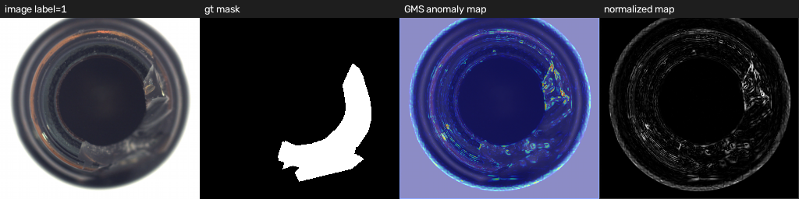

基于 anomalib 实现 EdgeAD
===

本仓库在 [anomalib 2.7.0](https://github.com/open-edge-platform/anomalib) 的
`AnomalibModule` 框架下复现论文
**EdgeAD: Unsupervised Learning Model Based on Prior Knowledge Enhanced Image
Anomaly Detection of Heavy Railway Freight Cars**（IEEE TIM, 2025）的无监督
异常检测方法，并在 MVTec AD 上完成训练/测试/推理全流程。

实现严格遵循论文的两条主线：

1. **先验知识（边缘）增强**：用 Canny 提取边缘，构造边缘加权损失
   `L = L_E + λ_G·L_G + λ_S·L_S`；
2. **严格 RBI（reconstruction-by-inpainting）**：`k×k` 像素块随机划分为 `n`
   个互不相交子集，逐个子集遮挡后重建，只把“被遮挡区域”的重建像素拼回原图。

---

## 1. 环境

```bash
conda activate env01
```

`env01` 中已配置好（**请勿修改该环境**）：

| 组件 | 版本 |
| --- | --- |
| Python | 3.11 |
| anomalib | 2.7.0 |
| PyTorch | 2.15.0+cpu |
| OpenCV | 已安装（`cv2`） |

> 当前环境是 CPU-only，因此仓库默认提供“论文参数”和“CPU 快速验证参数”两套
> 命令。GPU 环境把 `--accelerator gpu` 传进去即可，代码路径一致。

---

## 2. 目录结构

```
.
├── PRD.md                  # 需求说明
├── README.md               # 本文档
├── assets/
│   └── EdgeAD-...-Detection.pdf   # 论文
├── datasets/
│   └── mvtec -> /mnt/d/dataset/mvtec_anomaly_detection  # MVTec AD
├── model.py                # 纯 PyTorch：U-Net、Canny、RBI 掩码、三种损失、异常图
├── lightning_model.py      # AnomalibModule 封装 + 严格 RBI 训练/推理
├── train.py                # 训练 / 测试 / 推理入口
├── export_onnx.py          # ONNX 导出、onnxruntime 推理与一致性校验
├── tests/
│   └── test_model.py       # 组件自检（U-Net / Canny / RBI / 损失）
├── scripts/
│   └── visualize_gms.py    # 生成异常图定性结果（outputs/qualitative/）
└── outputs/                # 训练产物（Lightning 版本目录、可视化、指标、ONNX）
```

组件自检：

```bash
python tests/test_model.py
```

---

## 3. 方法实现要点

### 3.1 网络与边缘提取

| 论文 | 代码 |
| --- | --- |
| Fig.5 对称 U-Net（3 次下采样 + skip） | `model.UNet` |
| Canny 边缘提取，TH1=100、TH2=400 | `model.canny_edge` |
| 边缘像素权重 1，其余 0 | `canny_edge` 返回 0/1 图 |

输入保持 `[0,1]`（不做 ImageNet 归一化），因为 U-Net 输出端是 `Sigmoid`，
Canny 阈值也按 0~255 像素定义；`PreProcessor` 只做 `Resize(256)`。
彩色输入（MVTec）先按 BT.601 转灰度再送 Canny。

### 3.2 严格 RBI

`model.make_rbi_masks` 生成掩码：

* 图像划分为 `ceil(H/k) × ceil(W/k)` 个 `k×k` 网格块；
* 每个样本把网格块随机分配给 `n` 个互不相交的子集；
* 返回 `n` 个 0/1 掩码，并集恰好覆盖全图（已用单元自检验证）。

训练/推理时（`lightning_model._rbi_construct_k`）：

1. 对第 `s` 个子集，输入 `I_X · (1 - M_s)`（被遮挡块置 0）；
2. U-Net 重建 `R_s`；
3. 只取 `R_s · M_s` 拼到输出上，未遮挡区域保留原图像素：

```
I_Y = Σ_s R_s·M_s + I_X·(1 - Σ_s M_s)
```

这正是论文 Sec. II-E 的“重建被遮挡区域并组合成完整重建图”，没有使用
“整图重建 + 随机擦除”之类的近似。

### 3.3 多 K 组合

论文最优 `K=(8,16)`。每个 `K` 独立走一遍严格 RBI 得到 `I_Y^(k)`：

* 训练损失取各 `K` 的损失平均；
* 推理异常图取各 `K` 的异常图平均（默认 `1-GMS`，见 3.5）。

### 3.4 损失（论文 Eq.1~5）

`model.EdgeWeightedLoss`：

* `L_E = mean(E · SmoothL1(I_X, I_Y))`，只在边缘像素计算，按 `W·H` 归一化；
* `L_G = 1 - mean((2·g_a·g_b + c)/(g_a² + g_b² + c))`，Sobel 梯度幅值，`c=0.0026`；
* `L_S = 1 - mean(SSIM)`，11×11 高斯窗（σ=1.5），`C1=0.01², C2=0.03²`；
* `L = L_E + λ_G·L_G + λ_S·L_S`，论文 `λ_G=λ_S=1`。

> 与初版实现的差异：初版 `_rbi_forward` 未实现（直接调用会 `AttributeError`），
> 且训练时把“整图重建”和“带掩码重建”各算一次损失再平均，既不是严格 RBI，
> 也没有实现多 K 组合。现版本已按论文重写。

### 3.5 异常图与评分

推理时对每个 `K` 做严格 RBI 重建，再计算异常图：

```
anomaly_map = mean_k  A(I_X, I_Y^(k))
pred_score  = max(anomaly_map)
```

`A(·)` 由 `--score-mode` 选择（`model.anomaly_map`）：

| 模式 | 定义 | 说明 |
| --- | --- | --- |
| `gms`（默认） | `1 - GMS`，逐像素梯度幅值相似度 | 与 EdgeAD 的 GMSD/边缘先验一致；在 MVTec 上定位效果最好 |
| `l1` | `mean_c(abs(I_X - I_Y))` | 论文所述“重建差异”的直接实现 |
| `ssim` | `1 - SSIM` | 结构差异图 |

选 `gms` 的原因：L1 差异会被瓶身反光/低频亮度主导，正常轮廓的误差反而
高于缺陷；GMS 只比较局部梯度结构，对“边缘被破坏”的缺陷更敏感。消融见第 5 节。
anomalib 的 `PostProcessor` 负责归一化、阈值和 `pred_mask`，`Evaluator` 计算
`image_AUROC / image_F1Score / pixel_AUROC / pixel_F1Score`。

---

## 4. 使用

### 4.1 训练 + 测试（论文参数，GPU 推荐）

```bash
conda activate env01
python train.py --category bottle \
  --epochs 300 --patience 40 \
  --base 64 --k 8 16 --n 3 \
  --batch-size 8 --lr 1e-4 \
  --accelerator gpu
```

### 4.2 CPU 快速验证（本机实际跑通的配置）

```bash
python train.py --category bottle \
  --epochs 12 --base 16 --k 8 --n 3 \
  --batch-size 8 --lr 5e-4 \
  --num-workers 0 --check-val-every-n-epoch 2 \
  --accelerator cpu
```

> `--num-workers 0`：本机 DataLoader 多进程需要命名管道，在受限运行环境下会
> 报 `PermissionError`；普通桌面环境可改为 4~8 提速。

### 4.3 只测试 / 只推理

```bash
# 加载训练好的 checkpoint 重新测一遍（会自动重跑验证集刷新归一化/阈值统计）
python train.py --test-only \
  --checkpoint outputs/EdgeADLightning/MVTecAD/bottle/v0/weights/lightning/model.ckpt \
  --category bottle --num-workers 0 --score-mode gms

# 训练/测试完成后额外保存可视化结果（outputs/.../images/）
python train.py --category bottle ... --predict
```

### 4.4 其他常用参数

| 参数 | 说明 |
| --- | --- |
| `--data-format` | `mvtec`（默认，MVTec AD 目录）或 `folder`（通用文件夹，自采集数据用） |
| `--data-root` | 数据集根目录，默认 `./datasets/mvtec` |
| `--category` | MVTec 类别，默认 `bottle`（仅 `--data-format mvtec`） |
| `--dataset-name` | folder 模式的数据集名，默认 `railway`（用于输出目录命名） |
| `--normal-dir` / `--abnormal-dir` | folder 模式的正常/异常图目录（相对 `--data-root`） |
| `--normal-test-dir` / `--mask-dir` | folder 模式的正常测试图 / mask 目录（可选） |
| `--test-split-mode` / `--val-split-mode` / `--val-ratio` | folder 模式的数据划分（只有正常图时用 `none` + `from_train`） |
| `--epochs` / `--max-steps` | 最大 epoch / 最大优化步数 |
| `--base` | U-Net 首层通道数（论文未给宽度；64 为论文规模，CPU 建议 8~16） |
| `--k` / `--n` | RBI 块大小集合 / 子集个数（论文 8 16 / 3） |
| `--th1` / `--th2` | Canny 阈值（论文 100 / 400） |
| `--score-mode` | 异常图定义：`gms`（默认）/ `l1` / `ssim`，见 3.5 |
| `--lam-g` / `--lam-s` | GMSD / SSIM 权重（论文 1 / 1） |
| `--check-val-every-n-epoch` | 每 N 个 epoch 验证一次 |
| `--test-only` / `--checkpoint` | 只加载 checkpoint 做测试 |
| `--resume` | 从 checkpoint 继续训练 |
| `--seed` | 随机种子（默认 42） |

训练产物：

```
outputs/EdgeADLightning/MVTecAD/<category>/vN/
├── images/                 # 测试集可视化（原图/异常图/预测掩码）
└── weights/lightning/model.ckpt
outputs/EdgeADLightning/<category>/test_metrics.json   # 测试指标
```

folder 模式下输出目录为 `outputs/EdgeADLightning/<dataset-name>/...`（没有 category 层级）。

### 4.5 ONNX 导出与推理

env01 中已具备 `onnx` / `onnxruntime` / `onnxscript`，无需改动环境。

```bash
# 导出 + 用 onnxruntime 对比 PyTorch 输出
python export_onnx.py export \
  --checkpoint outputs/EdgeADLightning/MVTecAD/bottle/v0/weights/lightning/model.ckpt \
  --output outputs/edgead.onnx --verify

# 用 ONNX Runtime 推理单张/多张图片，并保存三联图
python export_onnx.py infer --onnx outputs/edgead.onnx \
  --image datasets/mvtec/bottle/test/broken_large/000.png \
          datasets/mvtec/bottle/test/good/000.png \
  --save-dir outputs/onnx_pred
```

ONNX 模型约定：

| 项 | 说明 |
| --- | --- |
| 输入 `image` | `float32 [B, 3, 256, 256]`，RGB，范围 `[0,1]`（不归一化） |
| 输出 `anomaly_map` | `float32 [B, 1, 256, 256]`，原始异常图（默认 `1-GMS`） |
| 输出 `pred_score` | `float32 [B]`，异常图最大值 |
| 动态维度 | batch 维动态；空间尺寸固定为训练时的 `image_size` |
| opset | 17（可用 `--opset` 改） |

辅助文件：`outputs/edgead.json` 记录 `k_values`、`n`、`score_mode`、
`mask_seed` 以及验证集得到的 `image_threshold` / `pixel_threshold`，
部署时可直接用于阈值化。

> **关于随机掩码**：严格 RBI 的掩码在 PyTorch 推理时每次随机划分；ONNX 图
> 无法方便地表达这一随机过程，因此导出时用 `--mask-seed` 把掩码烘焙成常量
> （每个 K 一组覆盖全图的 n 个子集）。这让 ONNX 推理完全确定、可复现，
> 代价是固定了掩码划分；PyTorch 端随机掩码的多次平均结果会略有差异。
> 脚本中的 `EdgeADOnnxWrapper` 与 ONNX 图使用同一组掩码，`--verify` 在
> batch=2 上实测最大误差约 `1e-6`。

### 4.6 自采集铁路数据（Folder 模式）

`--data-format folder` 使用 anomalib 的通用 `Folder` 数据模块，**不需要套用
MVTec 目录结构**，目录名可以任意。

只有正常图时：

```
D:\data\railway\
└── train\                # 全部正常图
    ├── 0001.jpg
    ├── 0002.jpg
    └── ...
```

```bash
python train.py --data-format folder --data-root D:\data\railway \
  --dataset-name railway --normal-dir train \
  --test-split-mode none --val-split-mode from_train --val-ratio 0.1 \
  --skip-test \
  --base 16 --k 8 --n 3 --epochs 50 --num-workers 0
```

说明：

* 验证集从正常训练图中划出（`from_train`），因此 `image_AUROC` /
  `pixel_AUROC` / F1 在单类数据上无定义或为 nan，**训练时看 `train_loss` 即可**；
* 没有测试集时 `train.py` 会自动跳过测试阶段（也可以显式 `--skip-test`）；
* 部署阈值建议：在正常图上跑推理，取 `pred_score` 的 99%~99.5% 分位数作为
  阈值；ONNX 导出时该阈值也可以写入 `edgead.json` 的 `thresholds`；
* 灰度图会被 anomalib 的 `read_image` 自动转成 RGB，`in_ch=3` 可直接使用。

以后积累了一小批带 mask 的异常图，可以把 `abnormal_dir` / `mask_dir` 配上，
此时 pixel 指标才有意义：

```
railway/
├── train/good/
└── test/
    ├── good/
    ├── defect_a/
    ├── defect_b/
    └── mask/             # 文件名与异常图一一对应
```

```bash
python train.py --data-format folder --data-root D:\data\railway \
  --dataset-name railway --normal-dir train/good \
  --normal-test-dir test/good \
  --abnormal-dir test/defect_a test/defect_b \
  --mask-dir test/mask \
  --test-split-mode from_dir --val-split-mode same_as_test
```

> `--mask-dir` 必须**只包含与 `--abnormal-dir` 对应的 mask**：Folder 会把
> mask 目录中的所有文件按文件名与异常图匹配，数量不一致会报错。相对路径基于
> `--data-root`，也支持绝对路径。

---

## 5. 结果

> 以下为本机 CPU（无 GPU）上按 4.2 配置跑出的结果；完整 300 epoch / base 64
> 的论文复现需要 GPU。实验：MVTec AD `bottle`，209 张正常训练图，83 张测试图
> （20 good + 63 缺陷），12 epoch，base=16，K=(8,)，n=3，lr=5e-4，耗时约 1 小时。

### 5.1 主结果（anomalib Engine 输出）

| 指标 | 数值 |
| --- | --- |
| image_AUROC | **0.738** |
| image_F1Score | **0.875** |
| pixel_AUROC | **0.655** |
| pixel_F1Score | 0.155 |

原始分数（不做 PostProcessor 归一化/截断）的 image_AUROC 为 **0.842**，
pixel_AUROC 同为 0.655。Engine 的 `PostProcessor` 会把分数按验证集 min/max
映射到 `[0,1]` 并截断，缺陷图的 `1-GMS` 在平坦区域容易饱和到 1，产生并列，
导致 image_AUROC 从 0.842 降到 0.738；AUROC 的排序能力本身以原始分数为准。

### 5.2 异常图消融（同一 checkpoint）

| 异常图 | image_AUROC（原始分数） | pixel_AUROC |
| --- | --- | --- |
| `l1`（重建强度差） | 0.818 | 0.321 |
| `ssim` | 0.709 | 0.602 |
| `gms`（默认） | **0.842** | **0.655** |

L1 的 pixel_AUROC 低于 0.5：瓶身反光/轮廓等正常高频区域的强度误差大，
掩盖了真正的缺陷；GMS 只比较梯度结构，pixel_AUROC 提升到 0.655。

### 5.3 视觉结果

`outputs/qualitative/preview_*.png`（由 `scripts/visualize_gms.py` 生成）：



可以看到 GMS 异常图在右侧“瓶口破损”区域（与 GT mask 对应）响应最强，
而正常瓶身轮廓的响应明显更低。

### 5.4 耗时参考

CPU 上单步耗时（batch=8, 256×256，含 3 个子集前向/反传）：

| base | K | 单步时间 |
| --- | --- | --- |
| 8 | (8,) | ≈5 s |
| 16 | (8,) | ≈10 s |
| 16 | (8,16) | ≈19 s |

因此论文的 300 epoch 在 CPU 上不可行；仓库保留论文默认参数，同时给出可在
CPU 上完成的可复现配置。12 epoch 已能到 image_AUROC≈0.74/0.84、pixel_AUROC≈0.66；
继续训练（尤其换成 GPU + base 64 + 300 epoch）应会进一步提升。

复现第 5 节结果：

```bash
# 训练（约 1 小时）
python train.py --category bottle --epochs 12 --base 16 --k 8 --n 3 \
  --batch-size 8 --lr 5e-4 --num-workers 0 --check-val-every-n-epoch 2

# 用 GMS 异常图重新测试（写入 outputs/EdgeADLightning/bottle/test_metrics.json）
python train.py --test-only \
  --checkpoint outputs/EdgeADLightning/MVTecAD/bottle/v0/weights/lightning/model.ckpt \
  --category bottle --num-workers 0 --score-mode gms
```

---

## 6. 已知限制

* 当前 `env01` 为 CPU 版 PyTorch，训练速度受限；不影响代码正确性，GPU 环境
  直接复用同一套代码。
* 第 5 节结果来自 **12 epoch、base=16** 的 CPU 验证配置，远小于论文的
  300 epoch、标准 U-Net 规模，指标不代表方法上限；完整复现请用 4.1 的 GPU 配置。
* MVTec 原始图像为 900×900，`PreProcessor` 在线 Resize 到 256；CPU 上
  `num_workers>0` 在本受限环境会因命名管道权限失败，故默认 0。
* 论文在自建 TFDS 数据集上评测（灰度图、1400×1024 → padding）；本仓库用
  MVTec AD 验证方法可迁移性，指标与论文表格不可直接对比。
* `base`、优化器等论文未给出细节，仓库默认取标准 U-Net 宽度 64、Adam lr=1e-4。
* 默认异常图使用 `gms`（梯度结构偏差）而非原始 L1 差异；这是基于实验的
  后处理选择，`--score-mode l1` 可切回论文式的直接重建差异。
